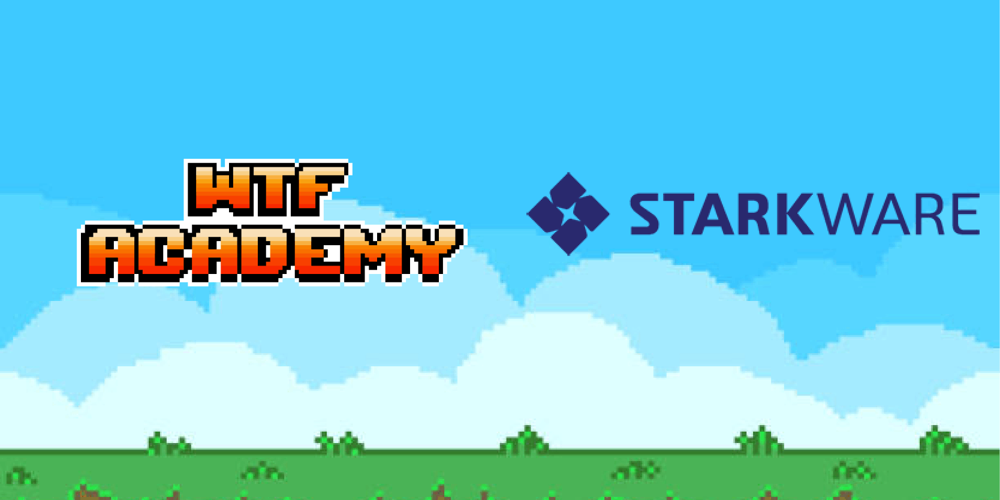

# WTF Starknet

WTF Starknet is an education platform to onboard developers to Starknet.

WTF Starknet是帮助开发者进入Starknet的教育平台。

Twitter: [@WTFAcademy_](https://twitter.com/WTFAcademy_) | [@0xAA_Science](https://twitter.com/0xAA_Science)

Community: [Discord](https://discord.gg/5akcruXrsk) | [Website: starknet.wtf.academy](https://starknet.wtf.academy)

## Tutorials 教程

1. [WTF Starknet Tutorials](./docs/starknet-101/readme.mdx): Introduction of the essentials of Starknet stacks. 介绍Starknet上的核心开发技巧。

2. [WTF Cairo Tutorial](https://github.com/WTFAcademy/WTF-Cairo): Open-source tutorials for Cairo (based on version 2.2), including 25 chapters. 开源的Cairo教程，共25讲。

## Starknet中文训练营（Starknet Basecamp Chinese）

🦄 Starknet中文训练营：一场为期7周的在线培训项目，专为开发者而设。

👑 旨在帮助开发者在以太坊Layer2 Starknet上开发应用🎫

💎 本活动由 WTF Academy 主办，Starknet中文社区 协办，Starknet基金会支持。

⏰ 日期： 2023年11月12日至12月22日，每周五晚8点，线上举行

💻 为了提高教学质量，本次训练营限制100人参与，报名截止日期：11月11日

🎬 所有教学视频和教程会全部上传 https://starknet.wtf.academy

💰 完成课程的学员将获得链上证书；优秀学员将获得奖学金，并且我们将协助申请Starknet早期社区成员计划（ECMP）

### 课程表 Calender

| 日期    | 课程                 | 主讲人      |
| ----- | ------------------ | -------- |
| 11.12 | 1.  Starknet基础     | [Zelig](https://github.com/JangoCCC)    |
| 11.19 | 2.  Cairo          | 0xNezha  |
| 11.26 | 3.  Starknet密码学基础   | Eli Ben-Sasson  |
| 12.3  | 4.  Starknet智能合约   | WongSSH  |
| 12.10 | 5.  合约测试           | 0xKrisss |
| 12.17 | 6.  Starknet去中心化应用 | Daxiong  |
| 12.24 | 7.  Starknet架构     | Asten    |
| 12.31 | 8.  生态先驱           | Leo      |

## 如何贡献 How to contribute

We will manage the project on GitHub (yes, this repo), so you can see all the tasks and contributors here. Please check issues for current tasks.

## WTF Contributors

  <h4 align="center">
    Contributors are the basis of WTF Academy
  </h4>
  

